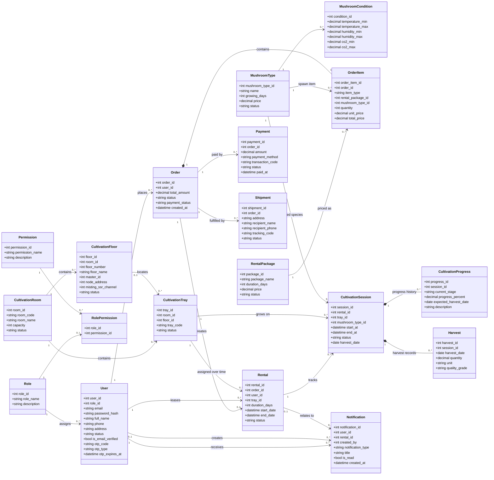
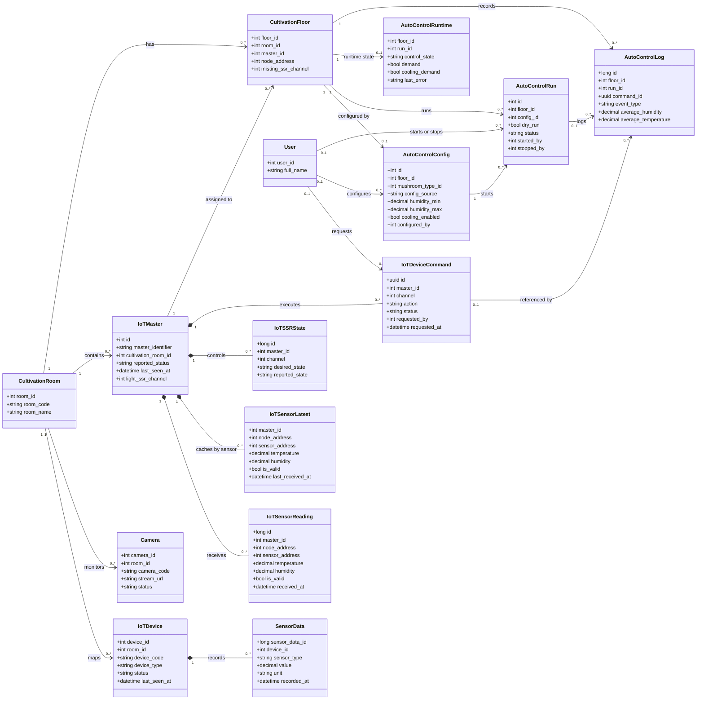
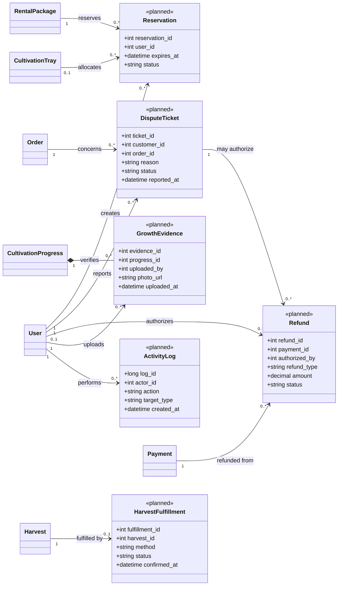

# Class Diagram - Mushroom Farm Backend

Sơ đồ được dựng từ schema PostgreSQL trong `database.sql`, các migrations và module backend hiện tại. `User` dùng `Role` để phân biệt Admin, Farm Operator và Customer; không có các lớp con riêng cho từng vai trò.

## 0. Cấu trúc module backend

```mermaid
classDiagram
    direction LR

    class RootRouter {
        <<module>>
        +mountFeatureRoutes()
    }
    class SwaggerRouter {
        <<module>>
        +serveApiDocs()
        +serveOpenApiJson()
    }

    class AuthRoutes {
        <<module>>
        +register()
        +login()
        +getCurrentUser()
        +registerOtp()
        +verifyRegistrationOtp()
        +forgotPassword()
        +resetPasswordOtp()
        +changePasswordOtp()
    }
    class UserRoutes {
        <<module>>
        +getCurrentUser()
        +listUsers()
        +createUser()
        +getUserById()
        +updateUserStatus()
    }
    class MushroomTypeRoutes {
        <<module>>
        +list()
        +getById()
        +create()
        +update()
        +remove()
    }
    class MushroomConditionRoutes {
        <<module>>
        +list()
        +getById()
        +create()
        +update()
        +remove()
    }
    class RentalPackageRoutes {
        <<module>>
        +list()
        +getById()
        +create()
        +update()
        +remove()
    }
    class CultivationRoomRoutes {
        <<module>>
        +list()
        +getById()
        +listRoomTrays()
        +create()
        +update()
        +remove()
    }
    class CultivationTrayRoutes {
        <<module>>
        +list()
        +getById()
        +create()
        +update()
        +remove()
    }
    class OrderRoutes {
        <<module>>
        +list()
        +getById()
        +createRentalOrder()
        +cancel()
    }
    class RentalRoutes {
        <<module>>
        +adminList()
        +adminCreateFromOrder()
        +startCultivation()
        +createProgress()
        +createHarvest()
        +completeRental()
        +cancelRental()
        +adminUpdate()
    }
    class PaymentRoutes {
        <<module>>
        +createPayosPayment()
        +getPaymentStatus()
        +payosWebhook()
    }
    class NotificationRoutes {
        <<module>>
        +list()
        +markRead()
        +markAllRead()
    }
    class IoTRoutes {
        <<module>>
        +listMasters()
        +getSensorReadings()
        +getSensorHistory()
        +controlSsr()
        +manageFloorAutomation()
    }
    class CameraRoutes {
        <<module>>
        +listCameras()
        +createCamera()
        +updateCamera()
        +deleteCamera()
        +getLiveStreams()
        +stopLiveStream()
    }

    class AuthController {
        <<module>>
        +register(req, res)
        +login(req, res)
        +me(req, res)
        +registerOtp(req, res)
        +verifyRegistrationOtp(req, res)
        +forgotPassword(req, res)
        +resetPasswordOtp(req, res)
    }
    class UserController {
        <<module>>
        +list(req, res)
        +getById(req, res)
        +create(req, res)
        +updateStatus(req, res)
    }
    class MushroomTypeController {
        <<module>>
        +list(req, res)
        +getById(req, res)
        +create(req, res)
        +update(req, res)
        +remove(req, res)
    }
    class MushroomConditionController {
        <<module>>
        +list(req, res)
        +getById(req, res)
        +create(req, res)
        +update(req, res)
        +remove(req, res)
    }
    class RentalPackageController {
        <<module>>
        +list(req, res)
        +getById(req, res)
        +create(req, res)
        +update(req, res)
        +remove(req, res)
    }
    class CultivationRoomController {
        <<module>>
        +list(req, res)
        +getById(req, res)
        +create(req, res)
        +update(req, res)
        +remove(req, res)
    }
    class CultivationTrayController {
        <<module>>
        +list(req, res)
        +listByRoom(req, res)
        +getById(req, res)
        +create(req, res)
        +update(req, res)
        +remove(req, res)
    }
    class OrderController {
        <<module>>
        +list(req, res)
        +getById(req, res)
        +create(req, res)
        +cancel(req, res)
    }
    class RentalController {
        <<module>>
        +adminList(req, res)
        +adminGetById(req, res)
        +adminCreateFromOrder(req, res)
        +adminCreateProgress(req, res)
        +adminCreateHarvest(req, res)
        +adminComplete(req, res)
        +adminCancel(req, res)
        +adminUpdate(req, res)
    }
    class PaymentController {
        <<module>>
        +createPayosPayment(req, res)
        +getPayosPaymentStatus(req, res)
        +payosWebhook(req, res)
    }
    class NotificationController {
        <<module>>
        +list(req, res)
        +markRead(req, res)
        +markAllRead(req, res)
    }
    class IoTController {
        <<module>>
        +list(req, res)
        +sensors(req, res)
        +history(req, res)
        +control(req, res)
    }
    class AutoMistingController {
        <<module>>
        +list(req, res)
        +environment(req, res)
        +configuration(req, res)
        +save(req, res)
        +start(req, res)
        +stop(req, res)
        +logs(req, res)
    }
    class CameraController {
        <<module>>
        +list(req, res)
        +getById(req, res)
        +create(req, res)
        +update(req, res)
        +remove(req, res)
        +listLiveStreams(req, res)
        +stopLiveSession(req, res)
    }

    class AuthService {
        <<module>>
        +register()
        +login()
        +registerOtp()
        +verifyRegistrationOtp()
        +forgotPassword()
        +resetPasswordOtp()
    }
    class UserService {
        <<module>>
        +getUsers()
        +getUserDetail()
        +createUser()
        +updateUserStatus()
    }
    class MushroomTypeService {
        <<module>>
        +getAllMushroomTypes()
        +getMushroomTypeById()
        +createMushroomType()
        +updateMushroomType()
        +deleteMushroomType()
    }
    class MushroomConditionService {
        <<module>>
        +getAllMushroomConditions()
        +getMushroomConditionById()
        +createMushroomCondition()
        +updateMushroomCondition()
        +deleteMushroomCondition()
    }
    class RentalPackageService {
        <<module>>
        +getAllRentalPackages()
        +getRentalPackageById()
        +createRentalPackage()
        +updateRentalPackage()
        +deleteRentalPackage()
    }
    class CultivationRoomService {
        <<module>>
        +getAllCultivationRooms()
        +getCultivationRoomById()
        +createCultivationRoom()
        +updateCultivationRoom()
        +deleteCultivationRoom()
    }
    class CultivationTrayService {
        <<module>>
        +getAllCultivationTrays()
        +getCultivationTraysByRoomId()
        +getCultivationTrayById()
        +createCultivationTray()
        +updateCultivationTray()
        +deleteCultivationTray()
    }
    class OrderService {
        <<module>>
        +createRentalOrder()
        +getCustomerOrders()
        +getCustomerOrderDetails()
        +cancelCustomerOrder()
    }
    class RentalService {
        <<module>>
        +getAllRentalsForAdmin()
        +getRentalByIdForAdmin()
        +createRentalFromOrderForAdmin()
        +createProgressForAdmin()
        +createHarvestForAdmin()
        +completeRentalForAdmin()
        +cancelRentalForAdmin()
    }
    class PaymentService {
        <<module>>
        +createPayosPayment()
        +getPayosPaymentStatus()
        +handlePayosWebhook()
    }
    class NotificationService {
        <<module>>
        +sendRentalNotification()
        +getNotifications()
        +markNotificationAsRead()
        +markAllNotificationsAsRead()
    }
    class IoTService {
        <<module>>
        +listMasters()
        +sensors()
        +sensor()
        +history()
        +ssr()
        +control()
    }
    class AutoMistingService {
        <<module>>
        +list()
        +environment()
        +configuration()
        +save()
        +start()
        +stop()
        +status()
        +logs()
        +evaluate()
    }
    class CameraService {
        <<module>>
        +getAllCameras()
        +getCameraById()
        +createCamera()
        +updateCamera()
        +deleteCamera()
        +getLiveStreams()
        +stopLiveStream()
    }

    class UserModel {
        <<module>>
        +findByEmail()
        +findById()
        +create()
        +findAllWithRole()
        +updateStatusById()
        +saveOtp()
        +markEmailVerified()
    }
    class MushroomTypeModel {
        <<module>>
        +findAll()
        +findById()
        +findByName()
        +create()
        +updateById()
        +removeById()
    }
    class MushroomConditionModel {
        <<module>>
        +findAll()
        +findById()
        +findByMushroomTypeId()
        +create()
        +updateById()
        +removeById()
    }
    class RentalPackageModel {
        <<module>>
        +findAll()
        +findById()
        +create()
        +updateById()
        +removeById()
    }
    class CultivationRoomModel {
        <<module>>
        +findAll()
        +findById()
        +create()
        +updateById()
        +removeById()
    }
    class CultivationTrayModel {
        <<module>>
        +findAll()
        +findById()
        +findFloorById()
        +create()
        +updateById()
        +removeById()
    }
    class OrderModel {
        <<module>>
        +findAllByUserId()
        +findByIdForUser()
        +createRentalOrder()
        +cancelOrderForUser()
    }
    class RentalModel {
        <<module>>
        +findAllForAdmin()
        +findByIdForAdmin()
        +createFromOrderForAdmin()
        +createProgressForAdmin()
        +createHarvestForAdmin()
        +completeForAdmin()
        +cancelForAdmin()
    }
    class PaymentModel {
        <<module>>
        +createOrGetPayosPayment()
        +savePayosPaymentLink()
        +markPayosPaymentAsPaid()
        +markPayosPaymentFailed()
        +findPayosPaymentStatus()
    }
    class NotificationModel {
        <<module>>
        +findRentalRecipient()
        +createForRental()
        +findAllByUserId()
        +markAsReadById()
        +markAllAsReadByUserId()
    }
    class IoTModel {
        <<module>>
        +findMasters()
        +findSensors()
        +findSensor()
        +history()
        +findSsr()
        +createCommand()
    }
    class AutoMistingModel {
        <<module>>
        +floor()
        +saveConfig()
        +createRun()
        +endRun()
        +runtimeSet()
        +log()
    }
    class CameraModel {
        <<module>>
        +findAll()
        +findById()
        +create()
        +updateById()
        +removeById()
    }

    class PostgreSQL {
        <<external>>
    }
    class PayOS {
        <<external>>
    }
    class MQTTBroker {
        <<external>>
    }
    class SwaggerSpec {
        <<config>>
    }

    RootRouter --> AuthRoutes : /auth
    RootRouter --> UserRoutes : /users
    RootRouter --> MushroomTypeRoutes : /mushroom-types
    RootRouter --> MushroomConditionRoutes : /mushroom-conditions
    RootRouter --> RentalPackageRoutes : /rental-packages
    RootRouter --> CultivationRoomRoutes : /cultivation-rooms
    RootRouter --> CultivationTrayRoutes : /cultivation-trays
    RootRouter --> OrderRoutes : /orders
    RootRouter --> RentalRoutes : /rentals
    RootRouter --> PaymentRoutes : /payments
    RootRouter --> NotificationRoutes : /notifications
    RootRouter --> IoTRoutes : /iot
    RootRouter --> CameraRoutes : /cameras

    AuthRoutes --> AuthController
    UserRoutes --> AuthController : current user
    UserRoutes --> UserController
    MushroomTypeRoutes --> MushroomTypeController
    MushroomConditionRoutes --> MushroomConditionController
    RentalPackageRoutes --> RentalPackageController
    CultivationRoomRoutes --> CultivationRoomController
    CultivationRoomRoutes --> CultivationTrayController : room trays
    CultivationTrayRoutes --> CultivationTrayController
    OrderRoutes --> OrderController
    RentalRoutes --> RentalController
    PaymentRoutes --> PaymentController
    NotificationRoutes --> NotificationController
    IoTRoutes --> IoTController : sensors and devices
    IoTRoutes --> AutoMistingController : floor automation
    CameraRoutes --> CameraController

    AuthController --> AuthService
    UserController --> UserService
    MushroomTypeController --> MushroomTypeService
    MushroomConditionController --> MushroomConditionService
    RentalPackageController --> RentalPackageService
    CultivationRoomController --> CultivationRoomService
    CultivationTrayController --> CultivationTrayService
    OrderController --> OrderService
    RentalController --> RentalService
    RentalController --> NotificationService : harvest notifications
    PaymentController --> PaymentService
    NotificationController --> NotificationService
    IoTController --> IoTService
    AutoMistingController --> AutoMistingService
    CameraController --> CameraService

    AuthService --> UserModel
    UserService --> UserModel
    MushroomTypeService --> MushroomTypeModel
    MushroomConditionService --> MushroomConditionModel
    MushroomConditionService --> MushroomTypeModel
    RentalPackageService --> RentalPackageModel
    CultivationRoomService --> CultivationRoomModel
    CultivationTrayService --> CultivationTrayModel
    CultivationTrayService --> CultivationRoomModel
    OrderService --> OrderModel
    RentalService --> RentalModel
    PaymentService --> PaymentModel
    NotificationService --> NotificationModel
    IoTService --> IoTModel
    IoTService --> AutoMistingModel : shared command locks
    AutoMistingService --> AutoMistingModel
    CameraService --> CameraModel

    UserModel --> PostgreSQL
    MushroomTypeModel --> PostgreSQL
    MushroomConditionModel --> PostgreSQL
    RentalPackageModel --> PostgreSQL
    CultivationRoomModel --> PostgreSQL
    CultivationTrayModel --> PostgreSQL
    OrderModel --> PostgreSQL
    RentalModel --> PostgreSQL
    PaymentModel --> PostgreSQL
    NotificationModel --> PostgreSQL
    IoTModel --> PostgreSQL
    AutoMistingModel --> PostgreSQL
    CameraModel --> PostgreSQL
    PaymentService --> PayOS : payment links and webhooks
    IoTService --> MQTTBroker : device commands
    AutoMistingService --> MQTTBroker : automation commands
    SwaggerRouter --> SwaggerSpec : API documentation
```

Sơ đồ dưới đây bao gồm **toàn bộ router hiện có**: 13 router nghiệp vụ được đăng ký trong `root.routes.js`, router tài liệu Swagger được gắn trực tiếp trong `app.js`, cùng root router. Nó nối từng router với controller, service và model tương ứng; `AutoMistingController` được truy cập qua `iot.routes.js`. Trong Express/CommonJS, đây là các module JavaScript export router/function/object, không phải các lớp khai báo bằng từ khóa `class`; stereotype `<<module>>` phản ánh đúng cấu trúc code. Một số model/service được dùng chung giữa nhiều luồng.

`swagger.routes.js` không thuộc `root.routes.js`: `app.js` gắn trực tiếp router này để phục vụ `/api-docs` và `/api-docs.json`.

## 1. Nghiệp vụ người dùng, đơn hàng và trồng nấm

## 2. IoT, cảm biến và tự động hóa

> `IoTDevice`/`SensorData` là cấu trúc tích hợp thiết bị dạng cũ; `IoTMaster` và các lớp `IoT*` là luồng MQTT/automation mới hơn. Sơ đồ giữ riêng hai cấu trúc vì chúng là các bảng riêng trong schema.

## 3. Lớp miền cần bổ sung để phủ đủ Functional Requirements

Các lớp dưới đây là đề xuất cho yêu cầu chức năng, **chưa có bảng tương ứng trong schema hiện tại**. Nên bổ sung trước khi triển khai các luồng này.

## Mapping với cấu trúc backend

Các lớp miền hiện có được truy cập theo luồng `routes -> controllers -> services -> models -> PostgreSQL`. Ví dụ, nhóm `rentalPackage`, `order`, `rental`, `cultivationTray`, `mushroomType`, `iot` và `autoMisting` có model/service tương ứng trong `src/`. Diagram tập trung vào entity và quan hệ dữ liệu, không biểu diễn từng lớp HTTP/controller.

Một số chênh lệch đáng chú ý giữa yêu cầu và backend hiện tại:

- OTP được xử lý trong `auth.service.js` và lưu trạng thái trên `users`; không có entity/bảng OTP độc lập.
- Schema có các bảng `rental_packages`, `cultivation_progress`, `harvests`, `notifications`, nhưng chưa có bảng giữ chỗ 5 phút, dispute ticket, refund authorization, ảnh xác minh tiến độ, fulfillment theo từng harvest hay activity log.
- Backend đã tích hợp PayOS. Để yêu cầu chức năng nhất quán với hệ thống, thay cụm “SePay” bằng “PayOS” trong yêu cầu thanh toán: “complete payments via integrated payment gateways (PayOS)”.
- Các lớp đề xuất trong mục 3 không được thể hiện như tính năng đã tồn tại.
